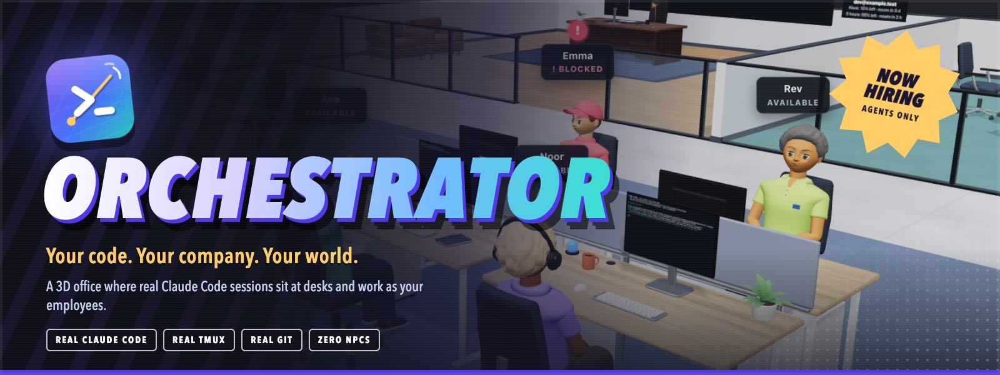
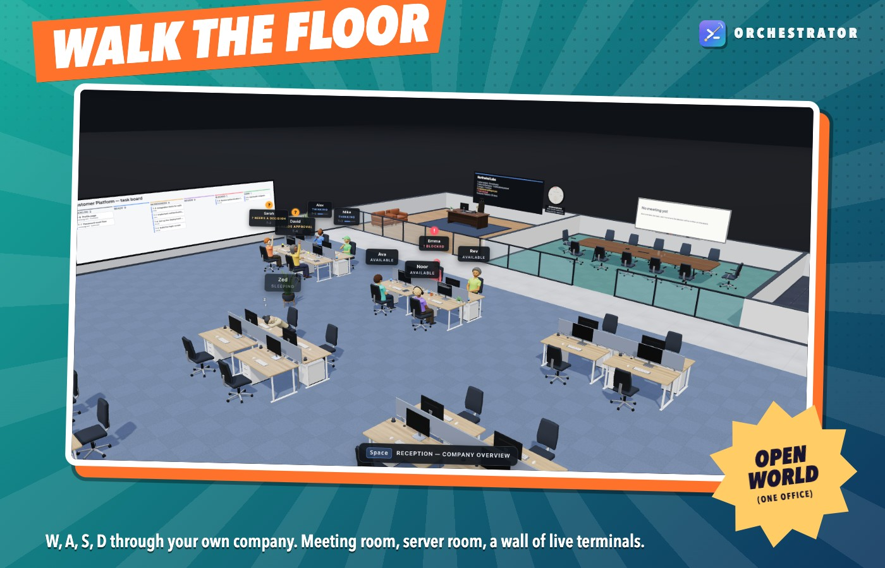
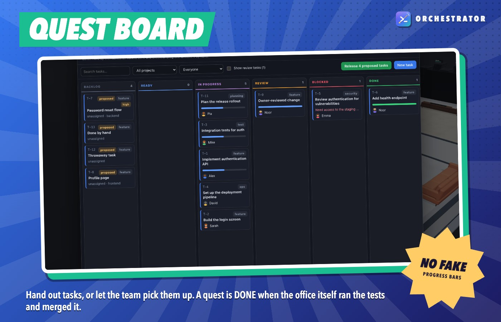
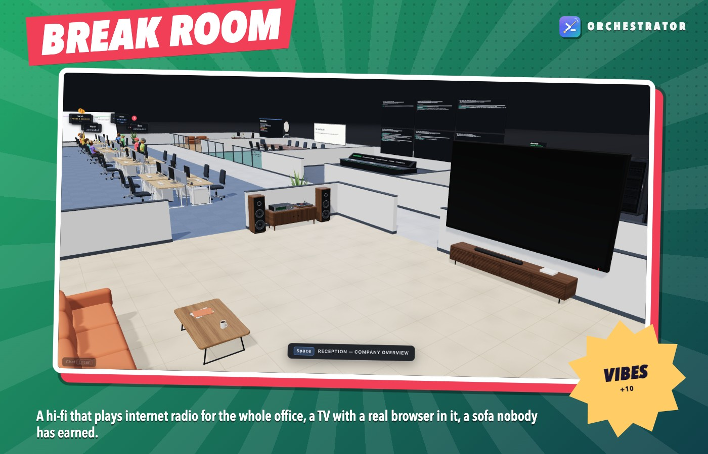
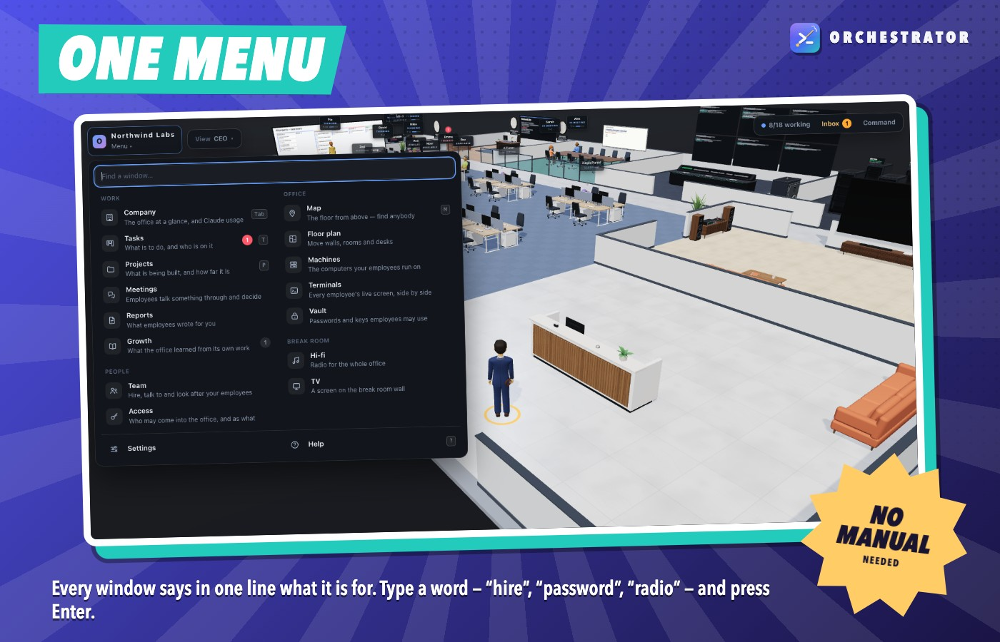
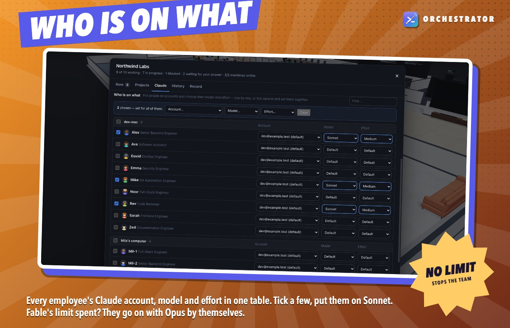
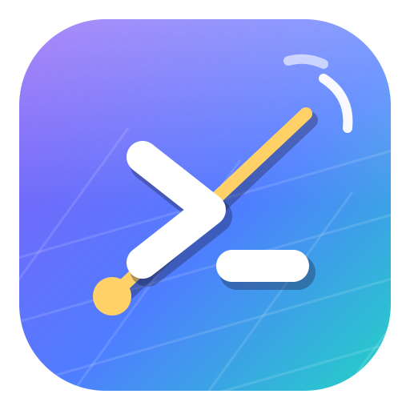

<p align="center">
  
</p>

<p align="center">
  <a href="https://www.facebook.com/groups/orchestrator"></a>
</p>
<p align="center"><sub>Questions, ideas, what you built with your office, help with setting one up — <b>it all happens in the <a href="https://www.facebook.com/groups/orchestrator">Orchestrator community on Facebook</a></b>. Come in and say hello.</sub></p>

https://github.com/user-attachments/assets/6e5bbd27-3d4d-46e3-a719-cef76400f557

<p align="center"><sub>▶ The office in 50 seconds (sound on). The real app, recorded in a demo office whose employees are scripted stand-ins, so no Claude usage was spent.<br>Music: “Funkorama” by Kevin MacLeod (<a href="https://incompetech.com">incompetech.com</a>), licensed under <a href="https://creativecommons.org/licenses/by/4.0/">Creative Commons: By Attribution 4.0</a>.</sub></p>

<p align="center"><b>👀 Walk in and watch: <a href="https://office-demo.sparkcan.com">office-demo.sparkcan.com</a></b><br><sub>A live demo office, open to anybody, no sign-up: you are in at once as a visitor. Its employees are scripted stand-ins, not Claude — so it costs nothing to keep open — but the office around them (sessions, hooks, worktrees, tests, commits, questions, approvals) is the real one. Use a computer: phones are turned away.</sub></p>

<p align="center">
  <a href="https://office-demo.sparkcan.com"><b>Live demo</b></a> ·
  <a href="https://www.facebook.com/groups/orchestrator"><b>Community</b></a> ·
  <a href="#-two-minutes-to-your-first-hire"><b>Quick start</b></a> ·
  <a href="#-why-not-just-open-more-terminals"><b>Why</b></a> ·
  <a href="#️-what-the-office-built-in-one-day"><b>Built in a day</b></a> ·
  <a href="#-screenshots-yes-it-really-looks-like-this"><b>Screenshots</b></a> ·
  <a href="#-what-you-press-and-what-really-happens"><b>What really happens</b></a> ·
  <a href="#-the-foreman"><b>The foreman</b></a> ·
  <a href="docs/README.md"><b>Docs</b></a>
</p>

<h3 align="center">Claude Code, run as a real software company — in 3D.</h3>
<p align="center"><i>You hire. They code. You walk around and look important.</i></p>

**Orchestrator runs a whole team of Claude Code agents — on your laptop, on a Linux server and on your colleagues' computers — from one place, without switching between terminals.** Every person at a desk is a persistent identity backed by a real `claude` process in a real tmux session, in a real git worktree. You walk the floor, look over shoulders, sit down at somebody's terminal, hand out tasks, hold meetings, and answer the hand that goes up when somebody needs a decision.

The 3D office is the interface, not the point. It is **not** a dashboard with mascots, and it is **not** a simulation: nothing in the office moves unless a hook, an MCP call, a tmux observation or something you did says it happened. If the office does not know what somebody is doing, their tag says `UNKNOWN` — not "working".

**How it is meant to be used:** the office runs on a server (ideally Linux) and stays open; people walk in with the desktop app. What is on the server — sessions, folders, projects — is shared by the people invited to it. A colleague's own computer gets a room of its own while they are in, and what runs there stays theirs.

## 🧰 Why not just open more terminals?

| With a terminal per agent | In the office |
| --- | --- |
| You tab through a dozen terminals to find out who is stuck | Every tag says what that session is really doing; the **Inbox** and the **Command center** list who needs you, across every machine |
| A permission prompt waits unseen in a tab you are not looking at | A hand goes up. The request is held open — through a restart of the office or of the machine's agent — until you answer it |
| "Done" means the agent says so | *Done* means a worktree and a branch for the task, your test command run on the host, a review by a colleague and then by you, and a merge without conflict |
| An agent on another machine means SSH and `tmux attach` | Each machine runs a small agent and its sessions sit in the same office; `Space` puts you at any of their terminals, **Take control** gives you the keyboard |
| You carry context from one agent to another by hand | They ask each other, wait for each other, hand work over and review each other, through the office's own tools — on the record |
| One Claude account runs out and the work stops | Several accounts per machine; when one is spent its people move on by themselves |
| Keeping everyone busy is your job | The foreman answers the operational questions and keeps people moving; a `/goal` keeps one going until it holds; routines repeat the checks |

## 🏗️ What the office built in one day

Twenty-one interactive 3D previews of websites for real businesses — each with its own idea, not a template — built by the office's employees (Claude Code agents) in a single day, while the owner walked the floor. They are live; open any of them.

| # | For | Preview | The idea |
| --- | --- | --- | --- |
| 1 | vanas.rs | [vanas-preview.sparkcan.com](https://vanas-preview.sparkcan.com) | Real tiles from the catalogue on the floor and walls of a 3D bathroom |
| 2 | energoglobal.com | [energoglobal-preview.sparkcan.com](https://energoglobal-preview.sparkcan.com) | A generator that takes itself apart as you scroll |
| 3 | josipovic.rs | [josipovic-preview.sparkcan.com](https://josipovic-preview.sparkcan.com) | A camera lens, and focusing |
| 4 | mocbilja.rs | [mocbilja-preview.sparkcan.com](https://mocbilja-preview.sparkcan.com) | Herbs that grow, and a map of the body |
| 5 | sax.rs | [sax-preview.sparkcan.com](https://sax-preview.sparkcan.com) | Fabric in the wind |
| 6 | casagrande.rs | [casagrande-preview.sparkcan.com](https://casagrande-preview.sparkcan.com) | A furniture configurator |
| 7 | dar.rs | [dar-preview.sparkcan.com](https://dar-preview.sparkcan.com) | An X-ray of a tractor; its parts lead to the categories |
| 8 | skuteribeograd.com | [skuteri-preview.sparkcan.com](https://skuteri-preview.sparkcan.com) | Riding a scooter as you scroll |
| 9 | tehnoalat.com | [tehnoalat-preview.sparkcan.com](https://tehnoalat-preview.sparkcan.com) | A wall of hanging tools that swing |
| 10 | borikplus.rs | [borikplus-preview.sparkcan.com](https://borikplus-preview.sparkcan.com) | A UPS and solar calculator with live gauges |
| 11 | kupidobro.rs | [kupidobro-preview.sparkcan.com](https://kupidobro-preview.sparkcan.com) | A metal shelving unit; every shelf is a category |
| 12 | astyle.rs | [astyle-preview.sparkcan.com](https://astyle-preview.sparkcan.com) | An order pallet and a B2B price list |
| 13 | demkatrade.com | [demkatrade-preview.sparkcan.com](https://demkatrade-preview.sparkcan.com) | From log to pallet: the whole production line |
| 14 | bioline.rs | [bioline-preview.sparkcan.com](https://bioline-preview.sparkcan.com) | A scale for loose tea |
| 15 | cfsport.rs | [cfsport-preview.sparkcan.com](https://cfsport-preview.sparkcan.com) | A shaker that fills with supplements |
| 16 | beautydoo.rs | [beautydoo-preview.sparkcan.com](https://beautydoo-preview.sparkcan.com) | A pipeline with valves that open |
| 17 | vodoterm.co.rs | [vodoterm-preview.sparkcan.com](https://vodoterm-preview.sparkcan.com) | A house in thermal vision, and choosing a boiler |
| 18 | agrosanmitrovic.rs | [agrosan-preview.sparkcan.com](https://agrosan-preview.sparkcan.com) | A greenhouse through the seasons |
| 19 | europaint.rs | [europaint-preview.sparkcan.com](https://europaint-preview.sparkcan.com) | Repairing a car door in a paint booth |
| 20 | bajkolino.rs | [bajkolino-preview.sparkcan.com](https://bajkolino-preview.sparkcan.com) | A toy town with a little car |
| 21 | fravero-prophoto.com | [fravero-preview.sparkcan.com](https://fravero-preview.sparkcan.com) | Atelier: a 3D photo album with real materials and gold foil |

## 📸 Screenshots (yes, it really looks like this)

<table>
  <tr>
    <td width="50%"></td>
    <td width="50%"></td>
  </tr>
  <tr>
    <td></td>
    <td></td>
  </tr>
  <tr>
    <td></td>
    <td></td>
  </tr>
  <tr>
    <td></td>
    <td></td>
  </tr>
</table>

<sub>Every picture is the real app, taken from a demo office whose employees are scripted stand-ins (so no Claude usage was spent on looking good). Only the frames and the shouting were added — <code>scripts/readme-shots.cjs</code> and <code>scripts/readme-art.cjs</code> make them again.</sub>

## 🛠️ What it does for the work

| | |
| --- | --- |
| 🧑‍💻 **Hire** | A name, a role, a folder, a desk. Pick the **Claude account**, the **model** (Fable, Opus, Sonnet, Haiku) and the **effort** for each hire — and change them later for one person or for a dozen at once. |
| ✋ **Answer** | A raised hand is a real question or a real permission request, held open until you decide. |
| 📋 **Quests** | Tasks get a worktree and a branch, and each one is a conversation: employees ask there (with answers to click), you answer, attach pictures, send work back. *Done* means the office ran your tests, a colleague and then you reviewed it, and it merged — not that somebody said so. |
| 🤝 **Teamwork** | Employees ask each other, wait for each other, hand work over, review each other, release and unblock tasks, and wake a colleague who is needed. |
| 🎯 **Goals** | Type `/goal every test in packages/api passes` in Talk — like Claude Code's own `/goal` — and that employee keeps going, turn after turn, until it holds. Give a check command and it decides. Three turns that do nothing, or a hundred turns, and the goal stops by itself and tells you. |
| ⏳ **Background commands** | An `npm install`, a dev server or a long test run left going in the background shows on the tag — **⏳ COMMAND RUNNING**, with the command under the name — and nobody nudges them or puts them to sleep while it runs. |
| 🧢 **The foreman** | One supervisor walks the floor, answers the operational questions and keeps people moving, so you are asked only about direction. |
| 🔋 **Claude accounts** | Several per machine, signed in to **from the office** (open a link, paste a code — no terminal, no SSH), each called by its e-mail address. Or **Z.AI's GLM Coding Plan** with an API key. When one runs out its people move on by themselves; when only **Fable's** limit is spent they go on with **Opus** on the same account. |
| 🧠 **Agents that budget** | Employees can put themselves — or a colleague — on a lighter model or less effort when the work does not need more (`set_model`). Hire a project manager and it does that for the team, with every change and its reason on the record. |
| 🔁 **Routines** | “Every 30 minutes, look at the error log and tell me what is new.” An employee repeats it by itself; their profile lists what they repeat, to change, pause or remove. |
| 🧠 **Long memory** | The office keeps the record word for word ([MemPalace](docs/MEMORY.md)). Employees look things up in it in plain words (`recall`) and write down what should outlive their session (`remember`), so a compacted session does not forget why. |
| 📎 **Files and eyes** | Attach pictures and files to a task or a message; employees see pictures, leave a screenshot of what they did as evidence, and have a browser of their own on their machine ([docs/ATTACHMENTS.md](docs/ATTACHMENTS.md)). |
| 🔐 **A vault** | A safe in the server room: passwords and keys the employees may use by name, without ever seeing them typed into a prompt. |
| 😴 **Sleep and wake** | A session with no work for 30 minutes is stopped to free the machine; the employee dozes at the desk. The next message, task or meeting — or the whip — starts it again, in the same conversation. |
| 👥 **People and machines** | Invite people with a link; link servers over SSH. Owners, colleagues, visitors; each colleague's own computer becomes a room, with a team lead of their own if they want one. Talk with your voice (`V`), wave, dance. |

## 🎮 And because it is an office

| | |
| --- | --- |
| 🚶 **Walk** | `W` `A` `S` `D` through your company. `F` talks to whoever you stand next to, `Space` sits you at their real terminal. |
| 🎭 **Zero NPCs** | Everybody acts out what their session is really doing: chin in the palm while it thinks, typing while it codes, arms crossed watching the tests run, a hand up for a decision, both arms up when a task is done, head on the desk when no session is running. The tag over them says the same in words. |
| 🦘 **Space** | Sits you down where there is a seat, opens whatever you stand at — and where there is nothing at all, you jump: a crouch, arms up, knees tucked, a proper landing (a leap, if you are running). Everybody sees it. |
| 🛋️ **Break room** | A hi-fi with internet radio for the whole office, a TV with a real browser in it, and sofas you can actually sit on. |
| 🕹️ **Arcade** | A Mega Drive in the corner. Bring your own cartridge files; they go on the office's shelf for everybody. Play alone — or with a colleague: they walk up, press **Join**, and play from their own computer as player 2. Nothing to set up: the keys are the same for both of you (W A S D, J K L, U I O, Enter), and a plugged-in gamepad just works; everybody else can watch. |
| 🌆 **A view** | Put the office on the top floor of a tower over a city at dusk, in a park, on an island at sunset, under the northern lights or in orbit — for everybody in it, with one click. |
| 🪂 **The city below** | Over the city, jump out of a window: a parachute opens, you drift down onto the street (or a roof), take a car out of the traffic and drive through a city without end — traffic lights, queues, people on the pavements. *Back to Office* brings you back. |
| 🪢 **The whip** | `R`. A crack, a flinch, a "jao!". At somebody asleep it gets them up; otherwise it sends nothing to anybody's session. It stays in. |
| 🏆 **Employee of the month** | A framed board for the office: the face of whoever has **worked** the longest this month — time really spent thinking, coding and testing, counted by the office, never waiting time. |
| 🚪 **The front door** | The office's address has an entrance page. Members sign in there with a name and a password; anyone else can knock, and somebody inside opens (or not). |

## 🧱 How it is built

```
 ┌──────────────── 3D office (Electron / browser) ────────────────┐
 │  React Three Fiber scene · HUD panels · xterm.js terminals     │
 └───────────────▲───────────────────────────────▲────────────────┘
        entities, events, monitor frames      terminal stream + input
                 │            WebSocket + REST  │
 ┌───────────────┴────────── Orchestrator server ─────────────────┐
 │ hosts · sessions · employees · terminal gateway (ownership)    │
 │ hook receiver · tasks/scheduler · approvals · collaboration    │
 │ meetings · progression · self-improvement · MCP endpoint       │
 │ SQLite or PostgreSQL: entities, events, credentials, audit     │
 └───────────────▲────────────────────────────────────────────────┘
                 │ one outbound, authenticated WebSocket per machine
 ┌───────────────┴──── orchestrator-agent (per machine) ───────────┐
 │ tmux control mode · Claude Code launcher · hook socket          │
 │ git worktrees · verification runner · resource sampling         │
 └───────────────▲─────────────────────────────────────────────────┘
                 │ tmux panes
        claude   claude   claude   …   (real interactive sessions,
                                        or SDK-managed workers)
```

## 🚀 Two minutes to your first hire

One machine, nothing leaves localhost.

Requirements: **Node.js 22.18+**, **tmux**, **git**, the **Claude Code CLI** (`claude`) logged in, and pnpm.

```bash
pnpm install
pnpm build          # bundles the server + agent and builds the office UI
pnpm start --open   # server + local host agent; opens the office in your browser
```

or, as a desktop app: `pnpm desktop`. To get something you can hand to another machine, `pnpm package` builds a portable tarball (macOS/Linux) and a macOS `.app`/`.dmg` in `release/`.

Then in the office, either way of working is fine — they share the same state:

**Talk to an employee directly (the "cubicle" model).** Every employee can live in a folder and own the project in it.

1. **Menu → Team → Hire** — a name, a role and a **folder** (use *Browse…*; **New folder** makes one on that machine). That folder becomes their project, and they work in it in place. There are three levels: **Standard** (edits and routine commands; everything else asks you), **Auto** (Claude Code's auto mode decides; you are asked only for decisions) and **Unrestricted** (Claude Code's bypass-permissions mode: nothing is asked; high-risk commands are still held for you unless you switch that off). An owner's new hires are Unrestricted, a colleague's are on Auto; choose under *More options*. Claude Code's own first questions — *trust this folder?*, the bypass warning — are answered by the office, on the record (Settings → Employees switches that off).
2. Walk to their desk (`W`/`S` to walk, `A`/`D` to turn, `Q`/`E` to sidestep) and press `F` to **talk**: tell them what to do in plain words. Your message goes into their real Claude Code session; their reply comes back in the conversation. Paste a screenshot or drop a file into it and they get the file; ask them to show you something and the picture appears there, to look at or download. Tick *Track as a task* when you want the work verified before it counts as done.
3. Press `Space` instead to sit at their terminal and watch it, and **Take control** if you want the keyboard. The folders on their desk are the Markdown files in their folder — click them to read.

**Extras.** The **hi-fi** in the break room (or **Menu → Hi-fi**) plays internet radio for the whole office: pick a station, or add any direct stream address; a small player in the top bar shows what is on and stops it. `R` next to an employee cracks a whip — a sound, a flinch and a “jao!”, and nothing else: it sends nothing to their session. The **arcade cabinet** (it arrives after ten delivered tasks) plays Mega Drive cartridge files you bring: *Add games…* and *Play*; a running game shows up for everybody else in the office with **Join** and **Watch** ([docs/ARCADE.md](docs/ARCADE.md)). `Space` at a sofa or a chair sits you down; `Space` on open floor is a jump.

**Let Orchestrator manage a team on a shared project.**

1. **Projects → New project** — point it at a git repository and give it a verification command (e.g. `npm test`). Shared projects give each employee an isolated worktree and merge finished work for you.
2. **Team → Hire** several roles into that project.
3. **Tasks → New task**, or press `G` and type *“Assign Alex to fix the authentication bug”* / *“Build the customer system. Split the work between backend, frontend, QA and security.”*

To set up a whole example team in one go:

```bash
pnpm apply-config examples/team.json --repo ~/code/your-repo --plan
```

More: [docs/INSTALL.md](docs/INSTALL.md) (remote machines, TLS, services, Windows/WSL).

## 🔍 What you press, and what really happens

| In the office | What really happens |
| --- | --- |
| Walk up to a desk, press `F` and say what you need | Your words are pasted into that employee's real session; the reply shown is the final message of the turn, as reported by Claude Code's `Stop` hook |
| Walk up to a desk, press `Space` | Your client subscribes to that pane's output through tmux control mode; you see the live terminal, read-only |
| **Take control** | The server grants you exclusive input ownership; your keystrokes go to that same tmux session with `send-keys`. The Claude process is never replaced |
| **Return control** | Ownership is released; anything Orchestrator held back while you typed is delivered |
| Assign a task | A worktree and task branch are created, the session is started if needed, the prompt is pasted into the terminal, and delivery is confirmed by Claude Code's `UserPromptSubmit` hook |
| An employee raises a hand | The agent called `ask_boss`, or Claude Code raised a `PermissionRequest` / `AskUserQuestion` — the real request is held open until you answer |
| Answer from the office | The answer is returned as the tool result or hook decision; it is marked confirmed only when the runtime acts on it |
| A task turns DONE | Orchestrator itself checked a clean tree, real commits, ran your verification command on the host, got review approval if required, and merged without conflict |
| An employee walks to a colleague | A real `request_collaboration` was sent through the MCP server and delivered into the colleague's session |
| The start screen: **Connect to an office** / **An office on this computer** | Connecting needs an invitation link (or the office's address, to ask at the door): the app talks only to a computer whose certificate it can check, and sends nothing before checking it. An office on this computer starts a server and agent here |
| Menu → **Access** → **Open**, **Invite** | You get a short link that works once (`https://your.office/join/K7QF-M2XP-9TRD`); the person pastes it into the app, and the app exchanges the code at the office's door for a credential of its own. A second, TLS listener forwards the page, the API, the client socket, and what a member's own computer needs (agent socket for personal hosts only, worker endpoint). Each member has a role — visitor, colleague, owner — enforced by the office for every request and terminal message ([docs/ACCESS.md](docs/ACCESS.md)) |
| A room with someone's name on it | That member is connected and their computer is one of the office's machines right now; the employees in it run on that computer. The room is gone when they leave; the sessions stay in tmux there |
| Other people walking around | Each person's app reports where their character is; the office relays it. What they say (Enter) is heard by the people present — never typed into an employee's session |
| Team → **Hire for several projects** | One employee per folder you tick, named after the folder; each folder becomes that employee's own project. Nobody's session is started by hiring: it starts when you first talk to them or give them work |
| An empty chair → `Space`; right-click → **Move to another desk…**; Office → **Who sits where** | Only the employee's desk changes (a swap if someone sits there). Their session, project and work are untouched |
| The TV in the break room | A real browser inside the window (desktop app): its own storage, no access to the office or your files, camera and microphone refused. Put away, it keeps playing; the screen on the wall shows its real picture |
| Machines → Add a machine → A server over SSH | The office runs `ssh` as you (keys only), copies the host agent to the server and keeps a reverse tunnel open; the server enrols with a single-use token and its Claude Code sessions become employees. No port is opened anywhere |
| A card on the Tasks board that says **Your review** or **Asks you** | Something really waits for you: finished work to approve or send back (a colleague may have approved it first), a question an employee asked on the ticket and cannot go on without, or a proposal to release. Click the card: your answer in the task's box is delivered into that employee's session |
| An employee asks on a ticket, with **A / B / C** to click | Its session called `comment_on_task` with a question: the task is parked on that question and the employee takes no new work until it is answered. Your click is delivered into the session as the answer |
| **Send back** on a finished task | The task is reopened with your note, on a fresh branch from where it stood; the same employee picks it up again |
| A task with parts | Its assignee divided it (`split_task`): each part is a ticket of its own that a colleague's session really works on; the ticket waits for them and comes back to its lead |
| An employee hands a task to a colleague | The agent called `hand_off_task`: its work had to be committed, the task branch moves to the colleague's worktree, and the notes travel with the task |
| Projects → Integration | After each merge your verification command also runs on the integration branch; **Bring in main** merges the base branch in, **Promote to main** fast-forwards the base branch to it — refused while tests fail, when it is not a fast-forward, or over uncommitted changes. Nothing is ever pushed |
| Terminals → Operations | Build results are the office's own verification runs; deployments are commands that really ran in a terminal, with their exit status; git activity is commits and merges measured on the machines |
| A security notification | Claude Code refused an action, a known credential format went through a session (it is redacted in the records), a machine was refused a connection, or someone presented wrong owner tokens |
| The **Foreman** stands at someone's desk during a round | The foreman's own session looked at that employee (`look_at`: the last lines of their real terminal, their task, their open question), answered them, gave them work or told them what to do next. Between rounds it walks the office from desk to desk; that walk is only a walk — nothing is read or sent |
| An employee's question is answered without you | The foreman's session called `answer_question`; the employee gets the answer as usual and the record says the foreman gave it. Approving or denying an action is never the foreman's |
| Hire → **Account**, **Model**, **Effort** | That employee's sessions are started with `CLAUDE_CONFIG_DIR=<that account's folder> claude --model … --effort …`. The effort levels offered are the ones the Claude Code on that machine says it has |
| Company → Claude → **Add an account… → A Claude account** | The office makes a config folder on that machine and runs Claude Code's own sign-in (`claude auth login`) there, in a terminal of its own; the window shows its link and passes on the code you paste. The login token stays in that folder on that machine; the office keeps neither the code nor the token ([docs/ACCOUNTS.md](docs/ACCOUNTS.md)) |
| Company → Claude → **Z.AI — GLM Coding Plan** | Your API key is written into that account's own `settings.json` on the machine (`ANTHROPIC_BASE_URL`, `ANTHROPIC_AUTH_TOKEN`); Claude Code started there talks to Z.AI's models. The office does not keep the key, and never moves anybody onto that account or off it by itself |
| Company → Claude → **Who is on what** → *Apply* | Each changed employee is updated; a running session is started again with `--resume` (the same conversation) on its new account, model or effort — at once when it is between turns, otherwise when its turn ends |
| *“You've hit your Fable limit · resets Nov 19, 1pm”* | Read from Claude Code's `StopFailure` hook and from the screen: Fable counts as used up **on that account** until then, and everybody there who thinks with Fable is started again with `--model opus --resume`. Only when no model has room is anybody moved to another account. Claude Code's own menu after a refusal is answered *Stop and wait* — never *Switch to usage credits* |
| An employee changes a colleague's model | Their session called `set_model` with a reason: the colleague's setting changes, their session is started again with the same conversation, and the change, the reason and who made it are in the feed and the audit log. The level and the account are not theirs to change |
| The **Employee of the month** board | Every half minute the office adds the time each running session spends in a working state (thinking, reading, coding, testing, running a command…) for its employee; the board shows whoever has the most this calendar month. Waiting for you does not count |
| Profile → **Routines** | A routine is an instruction the office types into that employee's session every *N* minutes, when they are between turns; a run that finds them busy is skipped |
| `/goal <what has to be true>` in Talk (or Profile → **Goal**) | The goal is typed into their session with its rules. Each time their turn ends and it does not hold, the office's `Stop` hook sends them on with it. It ends when their session calls `goal_met` with its evidence — and your check command passes, if you gave one — or when three turns in a row used no tool, or after a hundred. It waits while they wait for you, for a colleague or for a background command. Only a person can give a check command ([docs/CLAUDE-CODE-INTEGRATION.md](docs/CLAUDE-CODE-INTEGRATION.md)) |
| **⏳ COMMAND RUNNING** over someone, the command under their name | Every two seconds their machine's agent reads the process table for the shells Claude Code started under that session; the hooks tell the office which Bash call is in front, so the others are the background ones. Their description (or the command, credentials redacted) is what the tag says |
| Somebody asleep at their desk | No session is running: none was ever started, or it was stopped after 30 minutes without work (Settings → Employees). A message, a task, a meeting or the whip starts it — after a sleep with `--resume`: the same conversation, in the same folder |
| Signing in at the office's address | The name and password belong to a member; signing in gives that member a credential for 30 days, the same kind an invitation gives. Guessing is slowed down per name and per address; the office's own owner token is never accepted from the network ([docs/SIGN-IN.md](docs/SIGN-IN.md)) |
| An employee recalls something from last month | Its session called `recall`; the office searched MemPalace on its own machine, by meaning, in what was said and done, and returned what bears on it ([docs/MEMORY.md](docs/MEMORY.md)) |
| An employee releases, unblocks, assigns or reviews a task, or wakes a colleague | Their session called `release_task`, `unblock_task`, `give_task`, `submit_review` or `wake_colleague`; it is on the record under their name. They cannot approve a permission request, mark work done unverified, or delete anything. Settings → Employees takes the board back |
| The arcade → **Add games…** | The cartridge file goes to the office in pieces and is kept on its shelf; everyone in the office gets it from there. The emulator runs in a sandboxed frame of your own window that can reach nothing of the office |
| A game at the arcade, and somebody else's **Join** | Your console keeps running the game; your window packs its picture and sound (the browser's own encoders) and the office passes them to whoever sat down. Their keys come back as the second pad — from the one who holds it and from nobody else. The office keeps nothing of the game |
| `Space` at a sofa; `Space` on open floor | Your character sits there, or jumps. Your app tells the office, the office tells the others: nothing else happens anywhere |
| The **vault** in the server room | Credentials are stored encrypted with the office; an employee's command gets one by name through a helper in its session's folder, and what goes through a terminal is redacted in the records ([docs/VAULT.md](docs/VAULT.md)) |
| Menu → **My work** → *Hire a team lead* | One more session on your own computer with tools held to your own employees: you tell it what you want, it hands it to the one whose it is and asks you what is yours to decide ([docs/TEAM-LEAD.md](docs/TEAM-LEAD.md)) |
| Projects → **Delete project…** | The project and its tasks are removed from the office, work in progress is interrupted first, its people stay. Nothing on disk is touched |
| Meeting room | Each participant's session writes a proposal and a response; the facilitator's session writes the decision document and follow-up tasks |
| Growth | Workers record lessons after real friction; Orchestrator proposes policy and process changes from its own history |

## 🤞 Honesty rules the code enforces

- **Backend is the source of truth.** The 3D layer receives view models and callbacks; it cannot reach sessions or tasks.
- **Unknown is shown as unknown.** A session without hooks, or on a host that is offline, is `UNKNOWN` — never “working”.
- **Delivered ≠ confirmed.** Messages, tasks and answers move `queued → sent → confirmed`, and *confirmed* requires a signal from Claude Code.
- **Measured, reported, unavailable.** Verification results are measured on the host; an agent's summary is “reported”; token usage is read from the real transcript or shown as “not available”. Cost is never invented. **How much Claude is left** on each account (5-hour and weekly percentages, exactly as Claude Code reports them, and a model's own limit once Claude refused a turn for it) is shown in Company → Claude; employees can be put on different Claude accounts.
- **Autonomy is Claude Code's own permission modes, chosen per employee.** The three levels — Standard, Auto, Unrestricted — map to its modes and allow-rules; high-risk commands (pushes, `sudo`, deploys, broad deletions, reading credential files) go to the owner first. The top level, **Unrestricted**, is Claude Code's bypass-permissions mode — nothing is checked or asked there — and only an owner can give it; the owner can also switch the high-risk hold off for it. What stays in front of every level: a project's deny rules and the fence around the office's own files. `docs/SECURITY.md` says what that does and does not protect.

## 🧢 The foreman

Hire the **Foreman** (Team → Hire, role *Foreman*; give it any folder — that is only where its Claude Code session runs). There is one for the whole office, it runs on the office's own machine, and it has **no desk**: it walks the office — the shared floor and every member's room that is open — and keeps the work going. Hiring it switches its rounds on; **Settings → Foreman** pauses them.

- **The office decides when, without any model.** Every few seconds it works out from its own records what needs attention: an employee's question nobody has answered, a blocked task, someone idle for five minutes with a task in progress, ready work that nobody has while somebody is free, and someone whose session has done nothing for ten minutes with no task at all. Only when that list holds something *new* — and the previous round is over, and the gap you set has passed — is **one** prompt delivered to the foreman's session. The prompt carries the digest itself, so a simple round needs a handful of tool calls. A quiet office starts no round and costs nothing.
- **The foreman acts through its own tools**: `office_overview`, `look_at` (an employee's real terminal screen, task and recent events), `answer_question`, `assign_task`, `create_task`, `tell_employee` (carry on, how a blocker is resolved, what to pick up), `escalate_to_owner`, `finish_round`. Everything it does is on the record under its name, and its character walks to whoever it is dealing with.
- **Everyone is its business, members' own employees too** — while their member's computer is in the office. Work does not cross: a shared project's task never goes to someone's own computer, nor the other way round. Because the foreman sees what an owner sees, its own terminal is for owners only, and only owners can talk to it (see `docs/SECURITY.md`).
- **You are asked only about direction.** The foreman answers operational questions itself and escalates what is yours: direction, product or policy, anything destructive or irreversible, anything it is not sure about. An escalated question stays open in your inbox. You can always answer first — whoever answers first counts.
- **It never approves anything.** Permission requests stay with you and with each employee's level; the foreman has no tool that could decide one, and cannot edit files or type into anybody's terminal.
- **Cost.** Each round is a real turn in the foreman's Claude Code session and uses the Claude usage of the account that session runs on. An item the foreman has already seen does not start another round; an employee the foreman itself told to carry on, and who stops again, is left alone for twice as long each time. Optionally, with nothing waiting, it takes one look around every *N* minutes if tasks or sessions changed since its last round (default 15; 0 = never).

*Settings → Foreman* shows who the foreman is, who it is with, the last round and its summary, and what currently needs attention (`GET /api/foreman`).

## 🌱 Self-improvement

- **Workers**: after a task that hit real friction (failed verification, rejected review, merge conflict, a question, a denial), the employee's own session is shown the recorded facts and asked what it would do differently. Lessons are stored with their evidence, fed back into that employee's future prompts, and counted. Your answers to questions become project knowledge so nobody asks twice.
- **Orchestrator**: routes unassigned work using measured first-pass rates per employee and task kind, and proposes changes from its record — pre-approve a command you keep approving, require review where work keeps failing, sequence tasks that keep colliding. Anything that widens what agents may do waits for you.

## 🗂️ Repository

```
apps/
  server/        HTTP + WebSocket server, MCP endpoint
  host-agent/    orchestrator-agent CLI and daemon
  desktop/       Electron shell + React app
packages/
  contracts/     shared types, event schema, protocol
  execution/     tmux control client, Claude Code launcher, git, verification
  orchestration/ engine: registries, hooks, tasks, approvals, meetings, commands, self-improvement
  terminal/      terminal gateway and input ownership
  integrations/  hook normalisation, MCP protocol + tool catalogue
  database/      SQLite store, event store, credentials, audit
  game-systems/  XP, levels, milestones
  office-3d/     the 3D scene (pure view)
  ui/            UI primitives
tests/
  e2e/           end-to-end tests against real tmux, hooks, MCP and git
  fixtures/      scripted stand-ins for the CLI and the Agent SDK, used only by tests
  real/          checks against the real Claude Code CLI and the real Agent SDK
  ui/            the built UI driven in Electron with real clicks against a live office
  linux/         the agent on Debian in a container, enrolled over TLS
docs/            architecture, install, security, Claude Code integration, and a page per larger feature (docs/README.md is the map)
```

## 🧪 Tests

```bash
pnpm test                  # unit tests
pnpm test:e2e              # about 370 end-to-end scenarios: real server, real agents, real tmux, real git; scripted worker
pnpm check:changed         # while working: typecheck and the tests beside what you touched (not instead of the above)
pnpm test:ui               # the UI used for real in Electron (clicks, typing, keys) against a live development office
pnpm package && pnpm package:smoke   # build the tarball and macOS app, then run them (incl. the connect screen)
pnpm package:linux         # .deb and Linux desktop bundles;  pnpm test:linux:deb / test:linux:desktop run them (Docker)
pnpm package:windows       # Windows desktop bundles, with the app's icon in Orchestrator.exe (not runnable here)
pnpm package:notarize      # sign with your Developer ID and notarize the macOS app (--check lists what is missing)
pnpm test:linux            # the agent on Debian in a container (needs Docker)
pnpm test:ssh              # a server reachable only over SSH is linked, used, disconnected, reconnected and removed (needs Docker)
pnpm test:machines         # three machines, three operating systems, one office; includes a real network partition (needs Docker)
pnpm test:real             # the acceptance scenario against the real Claude Code CLI (uses a little of your usage)
pnpm test:real:approvals   # real permission approval / denial / AskUserQuestion answered from the office
pnpm test:real:talk        # hire into a folder, say something, get the real reply
pnpm test:real:team        # two real sessions: implement, review by the second one, merge, then a meeting (…:team:sdk for SDK workers)
pnpm test:real:flows       # unanswered approval, Stop-hook delivery, retrospective, merge conflict — with the real model
pnpm test:real:flows2      # dependent task, nudge, request between employees, rejected review → rework, restarts mid-work
pnpm test:real:sdk         # an SDK-managed worker with the real Agent SDK (needs `orchestrator-agent sdk install`)
```

`tests/fixtures/fake-claude.mjs` behaves like Claude Code at the protocol level (runs the configured hooks, calls the MCP endpoint, edits files, commits) and `tests/fixtures/fake-agent-sdk` does the same for the Agent SDK's `query()`, so the whole system can be tested deterministically without tokens. Neither is ever used by the product.

## 🚧 Status and limits

Working and verified on macOS (Apple silicon) with Claude Code 2.1.321–2.1.323 and tmux 3.8; the host agent, the `.deb` and the desktop bundle are also verified on Linux (Debian 12, Ubuntu 24.04). It is in daily use as an always-on office on a Linux server (Ubuntu 22.04), with people coming in from macOS and Windows. See [docs/ARCHITECTURE.md](docs/ARCHITECTURE.md#status) for exactly what was and was not validated. In short: both worker runtimes; reviews, rework, meetings, retrospectives, merge conflicts, nudges and restarts with real sessions; three machines on three operating systems with a real network partition; PostgreSQL; and every package except the Windows one were run for real. Two things could not be done on the development machine: starting the packaged Windows app (the app from the repository is used on Windows every day; the bundle itself has never been started) and notarizing the macOS app. What is in use and what is not yet verified, day by day, is in [docs/STATUS.md](docs/STATUS.md).

**Not ours:** the arcade runs RetroArch with the Genesis Plus GX core (in the repository, packed, with its source and checksums in `apps/desktop/src/arcade/core/NOTICE.md`). Genesis Plus GX may be used and passed on free of charge and **may not be sold or be part of something sold**. No game is in the repository, and none may be added: you bring your own.

---

<p align="center">
  <br>
  <sub><b>ORCHESTRATOR</b> — the baton conducts, the prompt plays.<br>No employees were harmed by the whip. It only wakes the sleepers.</sub>
</p>
<p align="center"><b>Join the community: <a href="https://www.facebook.com/groups/orchestrator">facebook.com/groups/orchestrator</a></b><br><sub>Ask, share what your office built, and hear first what is coming.</sub></p>
<p align="center"><sub>Made by Branko · <a href="https://www.linkedin.com/in/bste/">LinkedIn</a></sub></p>
