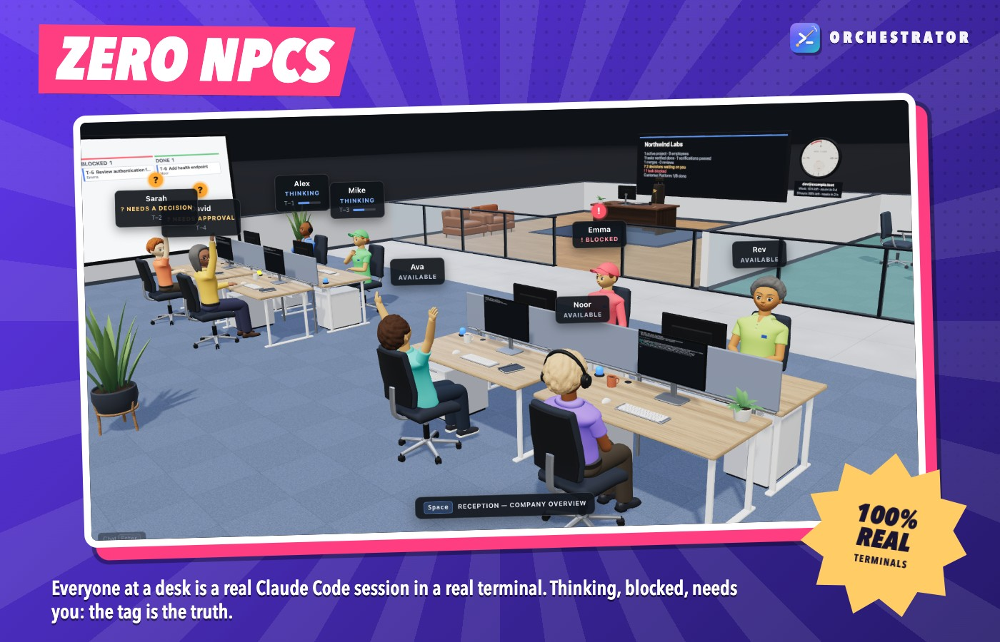
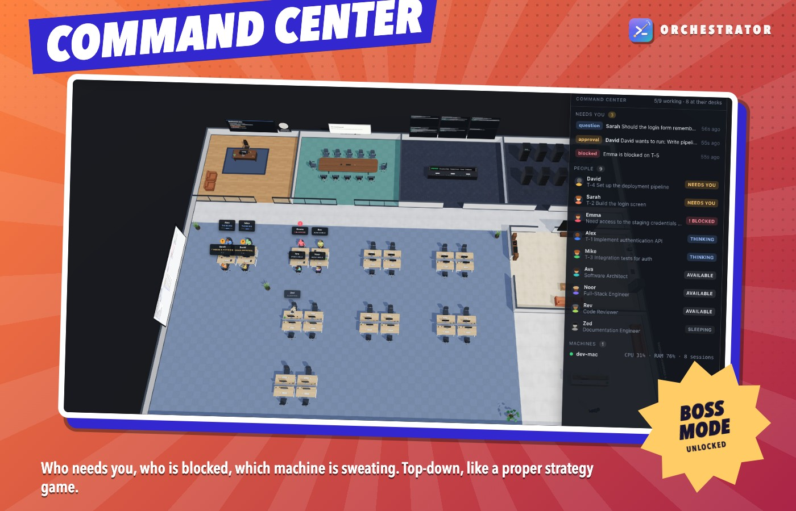
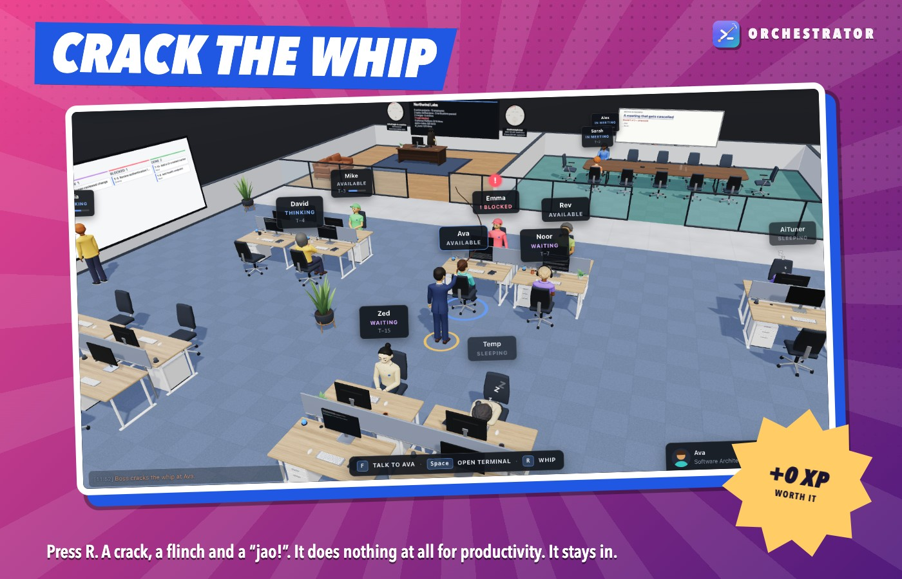

<p align="center">
  
</p>

<p align="center">
  <a href="#-two-minutes-to-your-first-hire"><b>Quick start</b></a> ·
  <a href="#-screenshots-yes-it-really-looks-like-this"><b>Screenshots</b></a> ·
  <a href="#-what-you-press-and-what-really-happens"><b>What really happens</b></a> ·
  <a href="#-the-foreman"><b>The foreman</b></a> ·
  <a href="docs/README.md"><b>Docs</b></a>
</p>

<h3 align="center">You hire. They code. You walk around and look important.</h3>

**Orchestrator is a 3D office in which real Claude Code sessions work as employees.** Every person at a desk is a persistent identity backed by a real `claude` process in a real tmux session, in a real git worktree. You walk the floor, look over shoulders, sit down at somebody's terminal, hand out tasks, hold meetings, and answer the hand that goes up when somebody needs a decision.

It is **not** a dashboard with mascots, and it is **not** a simulation: nothing in the office moves unless a hook, an MCP call, a tmux observation or something you did says it happened. If the office does not know what somebody is doing, their tag says `UNKNOWN` — not "working".

**How it is meant to be used:** the office runs on a server (ideally Linux) and stays open; people walk in with the desktop app. What is on the server — sessions, folders, projects — is shared by the people invited to it. A colleague's own computer gets a room of its own while they are in, and what runs there stays theirs.

## 📸 Screenshots (yes, it really looks like this)

<table>
  <tr>
    <td width="50%"></td>
    <td width="50%"></td>
  </tr>
  <tr>
    <td></td>
    <td></td>
  </tr>
  <tr>
    <td></td>
    <td></td>
  </tr>
</table>

<sub>Every picture is the real app, taken from a demo office whose employees are scripted stand-ins (so no Claude usage was spent on looking good). Only the frames and the shouting were added — <code>scripts/readme-shots.cjs</code> and <code>scripts/readme-art.cjs</code> make them again.</sub>

## 🎮 The game, if it were one

| | |
| --- | --- |
| 🧑‍💻 **Hire** | A name, a role, a folder, a desk. Pick the **model** (Fable, Opus, Sonnet, Haiku) and the **effort** for each hire. |
| 🚶 **Walk** | `W` `A` `S` `D` through your company. `F` talks to whoever you stand next to, `Space` sits you at their real terminal. |
| ✋ **Answer** | A raised hand is a real question or a real permission request, held open until you decide. |
| 📋 **Quests** | Tasks get a worktree and a branch. *Done* means the office ran your tests, got the review, and merged — not that somebody said so. |
| 🤝 **Teamwork** | Employees ask each other, wait for each other, hand work over, review each other, release and unblock tasks, and wake a colleague who is needed. |
| 🧢 **The foreman** | One supervisor walks the floor, answers the operational questions and keeps people moving, so you are asked only about direction. |
| 🛋️ **Break room** | A hi-fi with internet radio for the whole office and a TV with a real browser in it. |
| 🌆 **A view** | Put the office on the top floor of a tower over a city at dusk, in a park, on an island at sunset, under the northern lights or in orbit — for everybody in it, with one click. |
| 🪢 **The whip** | `R`. A crack, a flinch, a "jao!". It sends nothing to anybody's session. It stays in. |
| 👥 **Multiplayer** | Invite people with a link. Owners, colleagues, visitors; each colleague's own computer becomes a room. |

## 🧱 How it is built

```
 ┌──────────────── 3D office (Electron / browser) ────────────────┐
 │  React Three Fiber scene · HUD panels · xterm.js terminals     │
 └───────────────▲───────────────────────────────▲────────────────┘
        entities, events, monitor frames      terminal stream + input
                 │            WebSocket + REST  │
 ┌───────────────┴────────── Orchestrator server ─────────────────┐
 │ hosts · sessions · employees · terminal gateway (ownership)    │
 │ hook receiver · tasks/scheduler · approvals · collaboration    │
 │ meetings · progression · self-improvement · MCP endpoint       │
 │ SQLite or PostgreSQL: entities, events, credentials, audit     │
 └───────────────▲────────────────────────────────────────────────┘
                 │ one outbound, authenticated WebSocket per machine
 ┌───────────────┴──── orchestrator-agent (per machine) ───────────┐
 │ tmux control mode · Claude Code launcher · hook socket          │
 │ git worktrees · verification runner · resource sampling         │
 └───────────────▲─────────────────────────────────────────────────┘
                 │ tmux panes
        claude   claude   claude   …   (real interactive sessions,
                                        or SDK-managed workers)
```

## 🚀 Two minutes to your first hire

One machine, nothing leaves localhost.

Requirements: **Node.js 22.18+**, **tmux**, **git**, the **Claude Code CLI** (`claude`) logged in, and pnpm.

```bash
pnpm install
pnpm build          # bundles the server + agent and builds the office UI
pnpm start --open   # server + local host agent; opens the office in your browser
```

or, as a desktop app: `pnpm desktop`. To get something you can hand to another machine, `pnpm package` builds a portable tarball (macOS/Linux) and a macOS `.app`/`.dmg` in `release/`.

Then in the office, either way of working is fine — they share the same state:

**Talk to an employee directly (the "cubicle" model).** Every employee can live in a folder and own the project in it.

1. **Menu → Team → Hire** — a name, a role and a **folder** (use *Browse…*). That folder becomes their project, and they work in it in place. New hires are on **Auto**: they do not ask for permission, only for decisions.
2. Walk to their desk (`W`/`S` to walk, `A`/`D` to turn, `Q`/`E` to sidestep) and press `F` to **talk**: tell them what to do in plain words. Your message goes into their real Claude Code session; their reply comes back in the conversation. Tick *Track as a task* when you want the work verified before it counts as done.
3. Press `Space` instead to sit at their terminal and watch it, and **Take control** if you want the keyboard. The folders on their desk are the Markdown files in their folder — click them to read.

**Extras.** The **hi-fi** in the break room (or **Menu → Hi-fi**) plays internet radio in your window: pick a station, or add any direct stream address; a small player in the top bar shows what is on and stops it. `R` next to an employee cracks a whip — a sound, a flinch and a “jao!”, and nothing else: it sends nothing to their session.

**Let Orchestrator manage a team on a shared project.**

1. **Projects → New project** — point it at a git repository and give it a verification command (e.g. `npm test`). Shared projects give each employee an isolated worktree and merge finished work for you.
2. **Team → Hire** several roles into that project.
3. **Tasks → New task**, or press `G` and type *“Assign Alex to fix the authentication bug”* / *“Build the customer system. Split the work between backend, frontend, QA and security.”*

To set up a whole example team in one go:

```bash
pnpm apply-config examples/team.json --repo ~/code/your-repo --plan
```

More: [docs/INSTALL.md](docs/INSTALL.md) (remote machines, TLS, services, Windows/WSL).

## 🔍 What you press, and what really happens

| In the office | What really happens |
| --- | --- |
| Walk up to a desk, press `F` and say what you need | Your words are pasted into that employee's real session; the reply shown is the final message of the turn, as reported by Claude Code's `Stop` hook |
| Walk up to a desk, press `Space` | Your client subscribes to that pane's output through tmux control mode; you see the live terminal, read-only |
| **Take control** | The server grants you exclusive input ownership; your keystrokes go to that same tmux session with `send-keys`. The Claude process is never replaced |
| **Return control** | Ownership is released; anything Orchestrator held back while you typed is delivered |
| Assign a task | A worktree and task branch are created, the session is started if needed, the prompt is pasted into the terminal, and delivery is confirmed by Claude Code's `UserPromptSubmit` hook |
| An employee raises a hand | The agent called `ask_boss`, or Claude Code raised a `PermissionRequest` / `AskUserQuestion` — the real request is held open until you answer |
| Answer from the office | The answer is returned as the tool result or hook decision; it is marked confirmed only when the runtime acts on it |
| A task turns DONE | Orchestrator itself checked a clean tree, real commits, ran your verification command on the host, got review approval if required, and merged without conflict |
| An employee walks to a colleague | A real `request_collaboration` was sent through the MCP server and delivered into the colleague's session |
| The start screen: **Connect to an office** / **An office on this computer** | Connecting needs an invitation link (or the office's address, to ask at the door): the app talks only to a computer whose certificate it can check, and sends nothing before checking it. An office on this computer starts a server and agent here |
| Menu → **Access** → **Open**, **Invite** | You get a short link that works once (`https://your.office/join/K7QF-M2XP-9TRD`); the person pastes it into the app, and the app exchanges the code at the office's door for a credential of its own. A second, TLS listener forwards the page, the API, the client socket, and what a member's own computer needs (agent socket for personal hosts only, worker endpoint). Each member has a role — visitor, colleague, owner — enforced by the office for every request and terminal message ([docs/ACCESS.md](docs/ACCESS.md)) |
| A room with someone's name on it | That member is connected and their computer is one of the office's machines right now; the employees in it run on that computer. The room is gone when they leave; the sessions stay in tmux there |
| Other people walking around | Each person's app reports where their character is; the office relays it. What they say (Enter) is heard by the people present — never typed into an employee's session |
| Team → **Hire for several projects** | One employee per folder you tick, named after the folder; each folder becomes that employee's own project. Nobody's session is started by hiring: it starts when you first talk to them or give them work |
| An empty chair → `Space`; right-click → **Move to another desk…**; Office → **Who sits where** | Only the employee's desk changes (a swap if someone sits there). Their session, project and work are untouched |
| The TV in the break room | A real browser inside the window (desktop app): its own storage, no access to the office or your files, camera and microphone refused. Put away, it keeps playing; the screen on the wall shows its real picture |
| Machines → Connect a server over SSH | The office runs `ssh` as you (keys only), copies the host agent to the server and keeps a reverse tunnel open; the server enrols with a single-use token and its Claude Code sessions become employees. No port is opened anywhere |
| An employee hands a task to a colleague | The agent called `hand_off_task`: its work had to be committed, the task branch moves to the colleague's worktree, and the notes travel with the task |
| Projects → Integration | After each merge your verification command also runs on the integration branch; **Bring in main** merges the base branch in, **Promote to main** fast-forwards the base branch to it — refused while tests fail, when it is not a fast-forward, or over uncommitted changes. Nothing is ever pushed |
| Terminals → Operations | Build results are the office's own verification runs; deployments are commands that really ran in a terminal, with their exit status; git activity is commits and merges measured on the machines |
| A security notification | Claude Code refused an action, a known credential format went through a session (it is redacted in the records), a machine was refused a connection, or someone presented wrong owner tokens |
| The **Foreman** stands at someone's desk during a round | The foreman's own session looked at that employee (`look_at`: the last lines of their real terminal, their task, their open question), answered them, gave them work or told them what to do next. Between rounds it walks the office from desk to desk; that walk is only a walk — nothing is read or sent |
| An employee's question is answered without you | The foreman's session called `answer_question`; the employee gets the answer as usual and the record says the foreman gave it. Approving or denying an action is never the foreman's |
| Hire → **Model**, **Effort** | That employee's sessions are started with `claude --model … --effort …`. The effort levels offered are the ones the Claude Code on that machine says it has |
| An employee releases, unblocks, assigns or reviews a task, or wakes a colleague | Their session called `release_task`, `unblock_task`, `give_task`, `submit_review` or `wake_colleague`; it is on the record under their name. They cannot approve a permission request, mark work done unverified, or delete anything. Settings → Employees takes the board back |
| Projects → **Delete project…** | The project and its tasks are removed from the office, work in progress is interrupted first, its people stay. Nothing on disk is touched |
| Meeting room | Each participant's session writes a proposal and a response; the facilitator's session writes the decision document and follow-up tasks |
| Growth | Workers record lessons after real friction; Orchestrator proposes policy and process changes from its own history |

## 🤞 Honesty rules the code enforces

- **Backend is the source of truth.** The 3D layer receives view models and callbacks; it cannot reach sessions or tasks.
- **Unknown is shown as unknown.** A session without hooks, or on a host that is offline, is `UNKNOWN` — never “working”.
- **Delivered ≠ confirmed.** Messages, tasks and answers move `queued → sent → confirmed`, and *confirmed* requires a signal from Claude Code.
- **Measured, reported, unavailable.** Verification results are measured on the host; an agent's summary is “reported”; token usage is read from the real transcript or shown as “not available”. Cost is never invented. **How much Claude is left** on each account (5-hour and weekly percentages, exactly as Claude Code reports them) is shown at the CEO desk; employees can be put on different Claude accounts.
- **Autonomy is Claude Code's own permission modes, chosen per employee.** The levels map to its modes and allow-rules; high-risk commands (pushes, `sudo`, deploys, broad deletions, reading credential files) go to the owner first. The top level, **Unrestricted**, is Claude Code's bypass-permissions mode — nothing is checked or asked there — and only an owner can give it; the owner can also switch the high-risk hold off for it. What stays in front of every level: a project's deny rules and the fence around the office's own files. `docs/SECURITY.md` says what that does and does not protect.

## 🧢 The foreman

Hire the **Foreman** (Team → Hire, role *Foreman*; give it any folder — that is only where its Claude Code session runs). There is one for the whole office, it runs on the office's own machine, and it has **no desk**: it walks the office — the shared floor and every member's room that is open — and keeps the work going. Hiring it switches its rounds on; **Settings → Foreman** pauses them.

- **The office decides when, without any model.** Every few seconds it works out from its own records what needs attention: an employee's question nobody has answered, a blocked task, someone idle for five minutes with a task in progress, ready work that nobody has while somebody is free, and someone whose session has done nothing for ten minutes with no task at all. Only when that list holds something *new* — and the previous round is over, and the gap you set has passed — is **one** prompt delivered to the foreman's session. The prompt carries the digest itself, so a simple round needs a handful of tool calls. A quiet office starts no round and costs nothing.
- **The foreman acts through its own tools**: `office_overview`, `look_at` (an employee's real terminal screen, task and recent events), `answer_question`, `assign_task`, `create_task`, `tell_employee` (carry on, how a blocker is resolved, what to pick up), `escalate_to_owner`, `finish_round`. Everything it does is on the record under its name, and its character walks to whoever it is dealing with.
- **Everyone is its business, members' own employees too** — while their member's computer is in the office. Work does not cross: a shared project's task never goes to someone's own computer, nor the other way round. Because the foreman sees what an owner sees, its own terminal is for owners only, and only owners can talk to it (see `docs/SECURITY.md`).
- **You are asked only about direction.** The foreman answers operational questions itself and escalates what is yours: direction, product or policy, anything destructive or irreversible, anything it is not sure about. An escalated question stays open in your inbox. You can always answer first — whoever answers first counts.
- **It never approves anything.** Permission requests stay with you and with each employee's autonomy level; the foreman has no tool that could decide one, and cannot edit files or type into anybody's terminal.
- **Cost.** Each round is a real turn in the foreman's Claude Code session and uses the Claude usage of the account that session runs on. An item the foreman has already seen does not start another round; an employee the foreman itself told to carry on, and who stops again, is left alone for twice as long each time. Optionally, with nothing waiting, it takes one look around every *N* minutes if tasks or sessions changed since its last round (default 15; 0 = never).

*Settings → Foreman* shows who the foreman is, who it is with, the last round and its summary, and what currently needs attention (`GET /api/foreman`).

## 🌱 Self-improvement

- **Workers**: after a task that hit real friction (failed verification, rejected review, merge conflict, a question, a denial), the employee's own session is shown the recorded facts and asked what it would do differently. Lessons are stored with their evidence, fed back into that employee's future prompts, and counted. Your answers to questions become project knowledge so nobody asks twice.
- **Orchestrator**: routes unassigned work using measured first-pass rates per employee and task kind, and proposes changes from its record — pre-approve a command you keep approving, require review where work keeps failing, sequence tasks that keep colliding. Anything that widens what agents may do waits for you.

## 🗂️ Repository

```
apps/
  server/        HTTP + WebSocket server, MCP endpoint
  host-agent/    orchestrator-agent CLI and daemon
  desktop/       Electron shell + React app
packages/
  contracts/     shared types, event schema, protocol
  execution/     tmux control client, Claude Code launcher, git, verification
  orchestration/ engine: registries, hooks, tasks, approvals, meetings, commands, self-improvement
  terminal/      terminal gateway and input ownership
  integrations/  hook normalisation, MCP protocol + tool catalogue
  database/      SQLite store, event store, credentials, audit
  game-systems/  XP, levels, milestones
  office-3d/     the 3D scene (pure view)
  ui/            UI primitives
tests/
  e2e/           end-to-end tests against real tmux, hooks, MCP and git
  fixtures/      scripted stand-ins for the CLI and the Agent SDK, used only by tests
  real/          checks against the real Claude Code CLI and the real Agent SDK
  ui/            the built UI driven in Electron with real clicks against a live office
  linux/         the agent on Debian in a container, enrolled over TLS
docs/            architecture, install, security, Claude Code integration
```

## 🧪 Tests

```bash
pnpm test                  # unit tests
pnpm test:e2e              # 165 end-to-end scenarios: real server, real agents, real tmux, real git; scripted worker
pnpm test:ui               # the UI used for real in Electron (clicks, typing, keys) against a live development office
pnpm package && pnpm package:smoke   # build the tarball and macOS app, then run them (incl. the connect screen)
pnpm package:linux         # .deb and Linux desktop bundles;  pnpm test:linux:deb / test:linux:desktop run them (Docker)
pnpm package:windows       # Windows desktop bundles (not runnable here)
pnpm package:notarize      # sign with your Developer ID and notarize the macOS app (--check lists what is missing)
pnpm test:linux            # the agent on Debian in a container (needs Docker)
pnpm test:ssh              # a server reachable only over SSH is linked, used, disconnected, reconnected and removed (needs Docker)
pnpm test:machines         # three machines, three operating systems, one office; includes a real network partition (needs Docker)
pnpm test:real             # the acceptance scenario against the real Claude Code CLI (uses a little of your usage)
pnpm test:real:approvals   # real permission approval / denial / AskUserQuestion answered from the office
pnpm test:real:talk        # hire into a folder, say something, get the real reply
pnpm test:real:team        # two real sessions: implement, review by the second one, merge, then a meeting (…:team:sdk for SDK workers)
pnpm test:real:flows       # unanswered approval, Stop-hook delivery, retrospective, merge conflict — with the real model
pnpm test:real:flows2      # dependent task, nudge, request between employees, rejected review → rework, restarts mid-work
pnpm test:real:sdk         # an SDK-managed worker with the real Agent SDK (needs `orchestrator-agent sdk install`)
```

`tests/fixtures/fake-claude.mjs` behaves like Claude Code at the protocol level (runs the configured hooks, calls the MCP endpoint, edits files, commits) and `tests/fixtures/fake-agent-sdk` does the same for the Agent SDK's `query()`, so the whole system can be tested deterministically without tokens. Neither is ever used by the product.

## 🚧 Status and limits

Working and verified on macOS (Apple silicon) with Claude Code 2.1.321/2.1.322 and tmux 3.8; the host agent, the `.deb` and the desktop bundle are also verified on Linux (Debian 12, Ubuntu 24.04). See [docs/ARCHITECTURE.md](docs/ARCHITECTURE.md#status) for exactly what was and was not validated. In short: both worker runtimes; reviews, rework, meetings, retrospectives, merge conflicts, nudges and restarts with real sessions; three machines on three operating systems with a real network partition; PostgreSQL; and every package except the Windows one were run for real. Three things could not be done on the development machine: running anything on Windows itself, testing on physically separate computers, and notarizing the macOS app.

---

<p align="center">
  <br>
  <sub><b>ORCHESTRATOR</b> — the baton conducts, the prompt plays.<br>No employees were harmed by the whip. It sends nothing.</sub>
</p>
